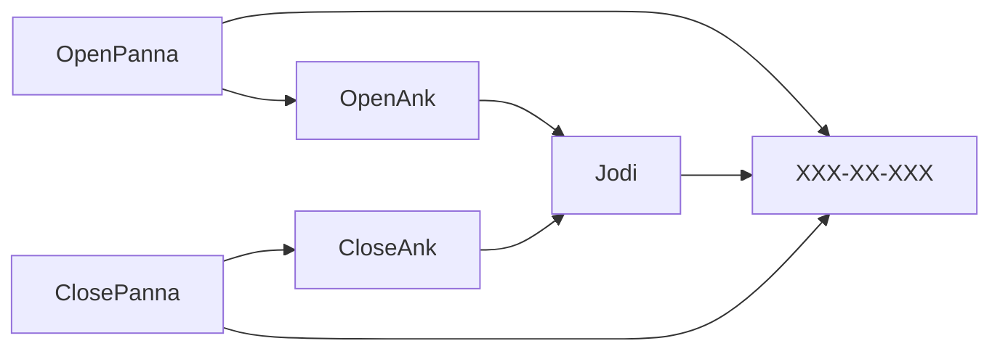

# Matka result line and bet settlement

Document how a Matka market result in `XXX-XX-XXX` form is derived, and how each listed bet is settled from that line. The first build is a pure rules module with tests. Screens, wallets, and payments stay out of this slice.

The repo is a blank React Native 0.88 app ([Mobile/App.tsx](Mobile/App.tsx)) and an empty Node package ([Server/package.json](Server/package.json)). This slice does not add screens or money movement. It encodes the shared game math so later play screens and an admin result entry can call one settlement function.

Payout multiples differ by operator (a single is often about 1:9.5, a jodi about 1:90–95, SP about 1:140–160, DP about 1:250–320, TP about 1:600–1000, half sangam about 1:1000, full sangam about 1:10000). Rates stay configuration. A bundle does not change the rate of the one number that hits; it only multiplies the stake.

## How `XXX-XX-XXX` is built

A market session has two draws. The published line is:

`open panna` - `jodi` - `close panna`

Example: `458-74-239`

- A **panna** (also patti or panel) is one of **220** three-digit numbers. Digits are written smallest to largest, and **0 sorts last** (treat 0 as 10). `4, 0, 1` is `140`, never `014` or `401`. `0, 0, 0` stays `000`.
- The **ank** (single digit) is the units digit of the three-digit sum: `(d1 + d2 + d3) % 10`.
  - Open `458`: `4+5+8 = 17` → ank **7**
  - Close `239`: `2+3+9 = 14` → ank **4**
- The **jodi** is those two anks in order, open then close: **74**. It is not a separate draw. If an admin enters both pannas, the jodi is derived. A typed line is invalid when the middle pair does not match both anks.
- Before the close is out, the board shows a half line such as `458-7`. Open-side bets can settle. Anything that needs the close ank or close panna stays pending.
- **Cut** of a digit is `(digit + 5) % 10`: `0↔5`, `1↔6`, `2↔7`, `3↔8`, `4↔9`.

Panna shapes, always inside the 220:

- **Single panna (SP):** three different digits. 120 exist. `458` is SP.
- **Double panna (DP):** one digit twice, the other different. 90 exist. `499` is DP. `000` is not DP.
- **Triple panna (TP):** all three digits the same. 10 exist: `000` through `999` in steps of 111.
- Each ank 0–9 owns exactly **22** pannas: 12 SP, 9 DP, 1 TP.

## Worked line `479-02-499`

- Open `479` is SP. `4+7+9 = 20` → open ank **0**.
- Close `499` is DP. `4+9+9 = 22` → close ank **2**.
- Jodi is **02**. `20` is a different jodi and loses.
- `02` is not a red jodi. Red means both digits equal, or one digit is the cut of the other.
- Winning half sangams: open panna `479` with close ank `2`, or open ank `0` with close panna `499`.
- Winning full sangam: `479` with `499`.

## What each bet wins against that line

A slip names a session (open or close) when the bet is one-sided. Jodi, red jodi, jodi family, half sangam, and full sangam are settled only after the close panna exists. They are not all accepted until the same cutoff. See [When a bet is accepted](#when-a-bet-is-accepted).

- **Single Digit.** One ank `0–9` on open or on close. Wins only on the chosen side. On `479-02-499`, open `0` wins and close `2` wins. Open `2` loses.
- **Single Digit Bulk.** The same stake on several anks. Each ank is its own slip. At most one can win per side.
- **Jodi.** Exact pair `00–99`, open ank then close ank. Only `02` wins. Settled after the close.
- **Jodi Bulk.** Several jodis, each its own slip. Only the exact declared pair pays.
- **Single Panna.** Exact SP on open or close. Open `479` wins. A different panna with the same ank, such as close `129` when the close ank is `2`, loses. Panna bets are digit-for-digit.
- **Single Panna Bulk.** Several SPs, same side, each its own slip.
- **Double Panna / Double Panna Bulk.** Same rule, limited to the 90 DPs. Close `499` wins.
- **Triple Panna.** Exact TP on one side. None wins on this line. The ten TPs are `000, 111, 222, 333, 444, 555, 666, 777, 888, 999`.
- **SD DP TP** (also called SP DP TP or the bracket of an ank). Choosing digit `D` on one side expands to all **22** pannas of that ank. On this line, open digit `0` includes `479`, so that one SP slip pays at the SP rate and the other 21 lose. Close digit `2` includes `499`, so that one DP slip pays at the DP rate.
- **SP Motor.** Pick at least 3 distinct digits. The slip list is every SP those digits can form: all 3-digit combinations, written in canonical order. Digits `4, 7, 9` produce only `479`. Digits `2, 4, 7, 9` produce `247, 249, 279, 479` (count is C(n, 3)). The declared panna on the chosen side must be in that list. Triples and doubles are not included.
- **DP Motor.** Pick at least 2 distinct digits. For every digit used twice and every other digit used once, emit the canonical DP. Count is `n * (n - 1)`. Digits `4, 9` produce `449` and `499`. `499` wins on the close of this line. TPs such as `444` are not included.
- **Red Jodi.** A fixed set of 20 jodis, not a different payout: twins `00, 11, 22, 33, 44, 55, 66, 77, 88, 99` and cut pairs `05, 50, 16, 61, 27, 72, 38, 83, 49, 94`. A red-jodi play is one or more of these (bulk of all 20 is the usual shortcut). Settlement is still exact jodi match. `02` is not in the set, so every red slip loses on this line. `00` or `05` would win only if that jodi were declared.
- **Panna Family.** Replace each digit of a panna by itself or its cut, then canonicalize. The 220 pannas fall into 35 families. Example family of `111`: `111, 116, 166, 666`. A family bet is one slip per member, on one side. It wins when the declared panna of that side is a member, at that panna’s own SP, DP, or TP rate.
- **Cycle Patti.** Two different anchor digits, plus every third digit `0–9`, canonicalized. Always 10 pannas, mixing SP and DP. Cycle `4-9` is `149, 249, 349, 449, 459, 469, 479, 489, 499, 490`. On this line, `479` hits on open and `499` hits on close if the cycle was played on that side. The other members lose. Played on both sides, each side is settled separately.
- **Jodi Family.** From a jodi, swap either digit, the other, or both for its cut, then take both orders. Distinct non-cut pairs expand to 8. Example from `02` (cuts `5` and `7`): `02, 07, 52, 57, 20, 70, 25, 75`. Twin and cut-pair families collapse to 4, such as `22, 27, 72, 77`. One member pays if it equals the declared jodi; the rest lose.
- **Half Sangam.** One panna and the ank of the **other** side. Two products, both settled only after the close:
  - Open panna + close ank. Winner here: `479` with `2`.
  - Open ank + close panna. Winner here: `0` with `499`.
  - The panna must match exactly. The ank must match the far side. Same-side pairs do not count.
- **Full Sangam.** Open panna and close panna together. Winner here: `479` with `499`. Order matters: open first, close second. The jodi is not part of the bet.

## When a bet is accepted

Each market has its own open time, close time, and cutoff. The default cutoff is 10 minutes before each draw. The admin enters a panna. The jodi is computed and is never typed.

- **Before the open cutoff:** every game is accepted, on the open side and the close side. That includes single, both bulks, SP, DP, TP and their bulks, SD DP TP, SP motor, DP motor, red jodi, panna family, cycle patti, jodi family, both half sangams, and full sangam.
- **After the open cutoff, including after the open panna is public:** open-side games are rejected. Both half sangams and full sangam are rejected, because each one names the open side. Close-side games, jodi, jodi bulk, red jodi, and jodi family stay open until the close cutoff. A jodi placed after the open ank is known still wins only when both digits match.
- **After the close cutoff, or after the close panna is declared:** every new bet is rejected.
- **Market cancelled or off:** no new bets. Unsettled slips are refunded their stake. Nothing is paid as a win.

A second declaration of the same panna pays nothing again. A different panna is rejected until that declaration is reversed. Reverse takes back the credits that declaration created. The corrected panna is then settled once.

Typed pannas may arrive in any digit order. `821` is stored as `128`. A number outside the 220 is rejected. A Single Panna screen accepts only an SP, a Double Panna screen only a DP, and a Triple Panna screen only a TP.

## Winning amount

The amount on a game screen is the stake per number. A motor, family, cycle, red jodi, or SD DP TP debits `count × stake`. Only the numbers that hit are paid.

`winningPaise = stakePaise × locked rate`

The rate is copied onto the slip when the bet is accepted. A later change to the market card does not change it. Money is integer paise, and the rate is an exact fraction, so 9.5 is `19/2`. A ₹100 single at 9.5 pays ₹950.

Default main-market card, overridable per market:

- Single 9.5
- Jodi 95
- Single panna 140
- Double panna 280
- Triple panna 700
- Half sangam 1000
- Full sangam 10000

SD DP TP, motors, panna family, and cycle patti do not have their own rate. Each generated panna pays at its SP, DP, or TP rate. Red jodi and jodi family pay at the jodi rate. Default limits are ₹10 to ₹10,000 per slip.

Open-side slips are credited when the open panna is declared. Jodi, sangam, and close-side slips are credited when the close panna is declared. Pending slips are not credited.

## Code

A small TypeScript package, [packages/matka-rules](packages/matka-rules), with no I/O. Server and app import it later.

- `panna.ts` — canonicalize, classify SP/DP/TP, ank, cut, and the generated list of 220.
- `result.ts` — build and parse a line; reject a jodi that disagrees with the pannas; represent a half result.
- `expand.ts` — pure expanders for bulk, SD DP TP, SP motor, DP motor, red jodi, panna family, cycle patti, and jodi family. Each returns the concrete slips and a stake total.
- `settle.ts` — given a result (or half result) and one slip, return pending, lost, or won with the rate key (`single`, `jodi`, `sp`, `dp`, `tp`, `halfSangam`, `fullSangam`).
- `rates.ts` — default rate card and `stakePaise × rate` in paise.
- `accept.ts` — accept a bet only in the correct phase, shape, and stake limits, and freeze the rate on each slip.
- `payout.ts` — `declareOpen`, `declareClose`, `reverseDeclaration`, and refunds for a cancelled market.
- Tests locked to `479-02-499`, `458-74-239`, a TP line such as `777` (ank 1, since `7+7+7 = 21`), a red jodi such as `16`, the family and motor examples, and the payout conditions above.

No wallet, result-admin API, or React Native screens in this slice. Play UI, once added, follows the existing screen split: `ScreenName/index.tsx` plus `ScreenName/styles.tsx`.

## Implementation checklist

- Add panna canonicalize, SP/DP/TP classify, ank, cut, and the 220 list.
- Parse and validate full and half `XXX-XX-XXX` results from the two pannas.
- Expand bulk, SD DP TP, motors, red jodi, families, and cycle patti into concrete slips.
- Settle each bet type against a full or half result, including rate keys.
- Lock settlement with known lines such as `479-02-499` and `458-74-239`.
- Freeze the rate at accept time and pay `stakePaise × locked rate` once per declaration.
